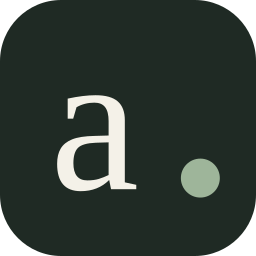
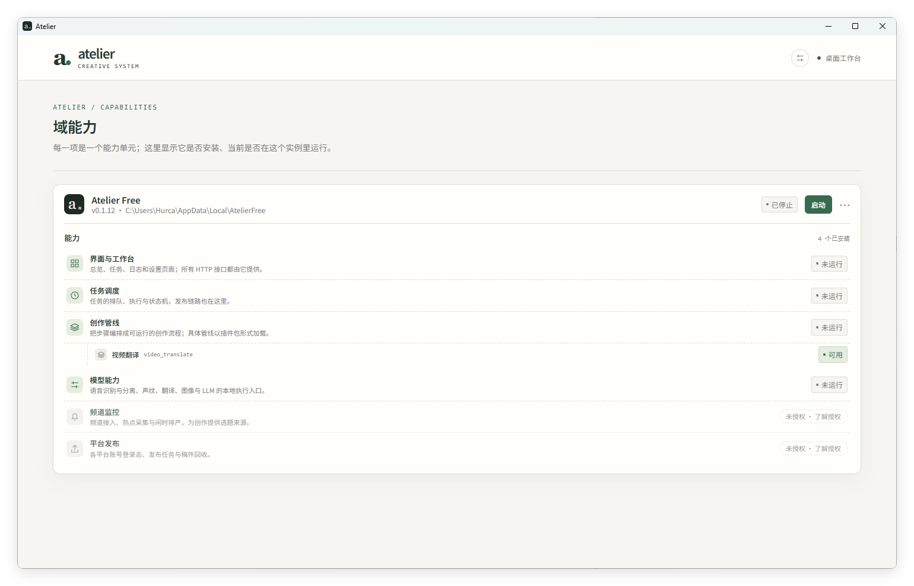
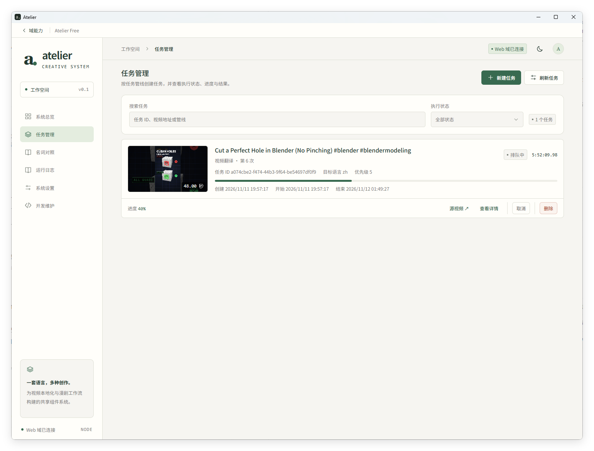
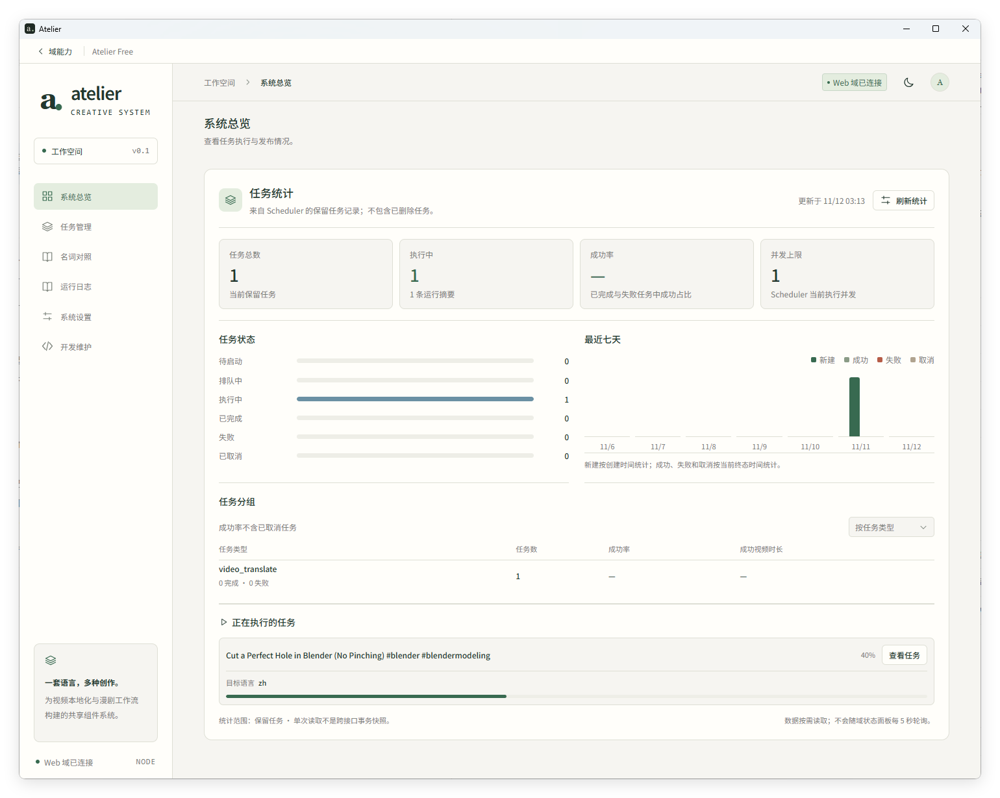
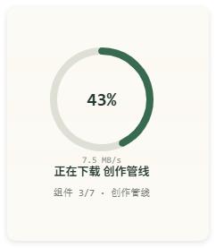

  

<h1 align="center">Atelier</h1>

让一句话、一段视频，变成可以直接发布的作品

  
  
  

产品页：<a href="https://nomadanget.github.io/Atelier/">nomadanget.github.io/Atelier</a>

---

## Atelier 是什么
Atelier 是一套装在 Windows 上的 **AI 创作工作台**：给它一个视频、一篇素材或一个想做的题目，它把重复的工序跑完——识别与切分、翻译、配音、字幕、封面、成片，最后整理好可以直接发布的东西。

它把「模型」当零件用：语音识别、说话人分离、声纹、翻译、图像、语音合成，各司其职；你用到的能力按需加载，不需要自己去拼环境、跑脚本。

## 能做什么

| 能力 | 说明 |
| :-- | :-- |
| 视频翻译 | 外语视频 → 中文成片：切分、识别、翻译、配音、字幕、封面一条链 |
| 创作管线 | 把多个步骤编排成一次可复用的流程 |
| 任务调度 | 排队、执行、中断续跑，跑多久都能看到进度 |
| 模型能力 | 语音识别、说话人分离、声纹、翻译、图像与本地大模型 |
| 频道监控 · 平台发布 | 订阅来源、按需产出、直接发布到平台（按授权启用） |

## 第一次打开

打开后是三页设置，每页都有图解，照做即可：

| 步骤 | 选什么 | 为什么 |
| :-- | :-- | :-- |
| 1 · 模型权重目录 | 权重放哪块盘 | 体积大、读写频繁，建议单独一块盘 |
| 2 · 权重下载令牌 | Hugging Face 令牌（可留空） | 部分模型要先在网页同意许可才能下载 |
| 3 · 项目数据目录 | 作品与数据库放哪 | 最容易长大的目录，方便备份和迁移 |

填完就开始工作。这些都是可以随时改的，已填的内容不会丢。

## 日常使用

| 想做的事 | 怎么做 |
| :-- | :-- |
| 开始 | 点「启动」，几十秒内进入工作台 |
| 暂时不用 | 点「停止」，任务会中断，数据不丢 |
| 装新版本 | `⋯` →「更新发行包」，有进度，装完自动接着启动 |
| 换目录 | 改 `launcher.json` 里的路径后重启（发布版不提供「重新运行初始设置」入口） |
| 结束 | 关窗口只是隐藏；托盘里可以真正退出 |

## 界面一览

   
  一屏看清装了哪些能力、是否在运行

   
  每个任务的进度、时长、源视频与产出都在一起

   
  任务统计与最近趋势

   
  更新与环境准备都有实时进度与下载速度，界面不会被锁住

## 配置建议

- **显卡**：本地模型需要 NVIDIA 显卡，显存 8 GB 起步，16 GB 更从容；
- **磁盘**：运行环境 + 模型权重合计 40 GB 以上，建议留 80 GB；
- **网络**：首次使用需要下载运行环境和权重，之后可离线工作。

## 出问题时

| 现象 | 先看这里 |
| :-- | :-- |
| 启动后迟迟进不去工作台 | 首次要准备运行环境，界面上有实时下载速度，速度不为 0 就是在干活 |
| 更新报错 | 报错会写明卡在哪一步、哪个组件；安装目录不会被写坏，重试即可 |
| 想回退 | 安装目录下保留着上一版的组件副本 |

详细说明见 [`docs/使用手册.md`](docs/使用手册.md)。

## 许可

Atelier 为专有软件，未经授权不得再分发。所用第三方组件的许可见 [`THIRD-PARTY-NOTICES.md`](THIRD-PARTY-NOTICES.md)。