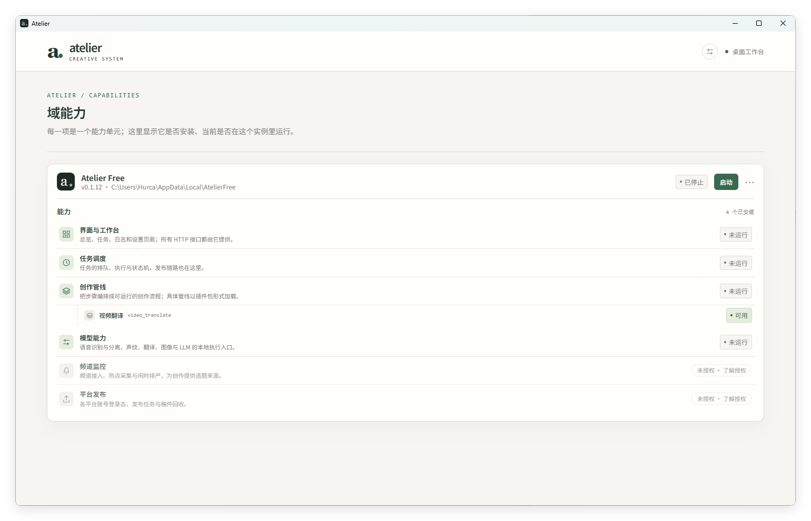
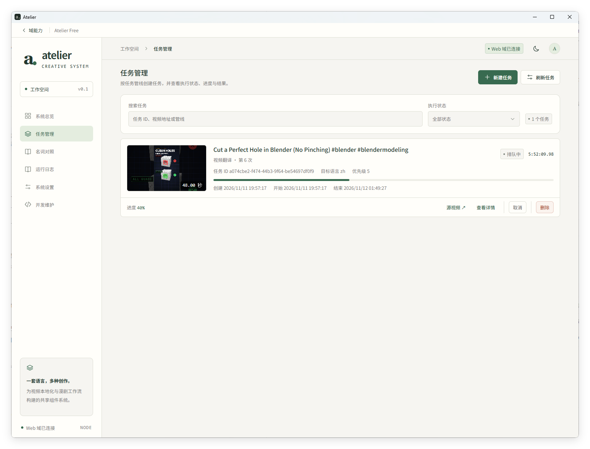
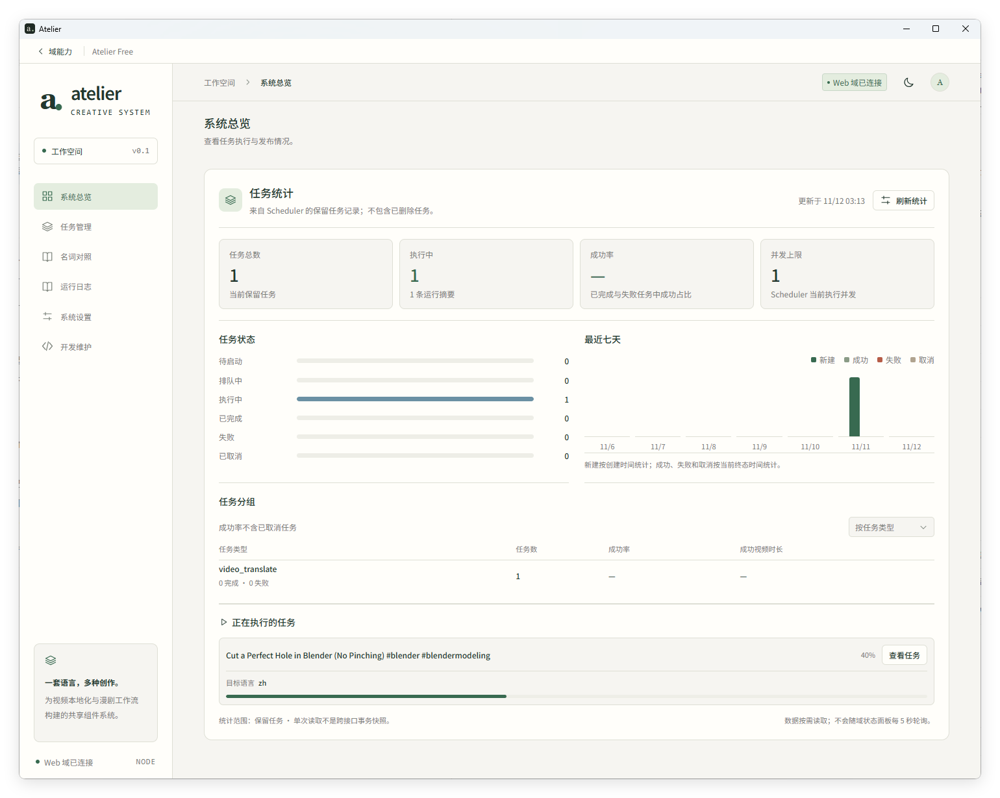
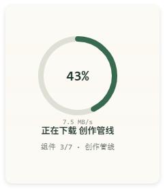

# Atelier 使用手册

> 面向使用者。技术细节见 `docs/dev/`。

## 一、第一次打开

1. 双击 Atelier 图标。
2. 出现三页设置，每页都有图解，照着选：

| 页 | 选什么 | 建议 |
| :-- | :-- | :-- |
| 模型权重目录 | 权重放哪块盘 | 选空间大的盘（建议留 80 GB 以上），不要放系统盘 |
| 权重下载令牌 | Hugging Face 令牌 | 可留空；要下载受限模型时再填 |
| 项目数据目录 | 作品与数据库 | 选方便备份的盘，以后会越来越大 |

3. 每页底部有"下一步"，全部填完后进入主界面。

## 二、主界面怎么看

- 顶部是当前安装的版本与状态（已停止 / 运行中）；
- 每一行是一个能力：**装了没**、**在跑没**；
- 灰色的两行（频道监控、平台发布）需要单独授权，点「了解授权」查看。

## 三、做一条视频

1. 点「启动」，等状态变成"运行中"（首次会准备运行环境，界面上有实时下载速度，速度不为 0 就是在干活）；
2. 进入工作台 →「任务管理」→「新建任务」；
3. 填视频地址、选目标语言、提交；
4. 回到「任务管理」看进度；每条任务显示阶段、时长、源视频缩略图与产出。

## 四、看总体情况

- 任务总数、执行中、成功率、并发上限；
- 最近七天的趋势；
- 正在执行的任务会单独列出来，可点「查看任务」。

## 五、更新

`⋯` →「更新发行包」：

- 全程有进度：下载（带实时速度）、校验、解压、替换、启动；
- 装完会自动启动，节省时间；
- 更新失败不会破坏现有安装，重试即可；
- 上一版的组件会保留在安装目录的 `.old-<版本>` 里，需要时可人工回退。

`⋯` →「更新启动器」用于更新应用本身（会短暂关闭并自动重开）。

## 六、常见问题

**点启动后很久进不去工作台？**
首次需要准备运行环境（下载依赖、构建环境），可能十几分钟。看进度上的下载速度，只要不为 0 就是正常的。

**任务卡住不动？**
先看「运行日志」里的最后几条。引擎在加载模型时会有一段时间没有新日志，属正常。

**想换目录 / 换令牌？**
`⋯` →「重新运行初始设置」。已填的内容不会丢，只改想改的那一页。

**关掉窗口会停止任务吗？**
不会。关窗口只是隐藏到托盘，任务继续跑。真正退出请用托盘菜单里的「退出」。

**要备份什么？**
项目数据目录（作品与数据库）最重要；模型权重目录可以重新下载，不必备份。